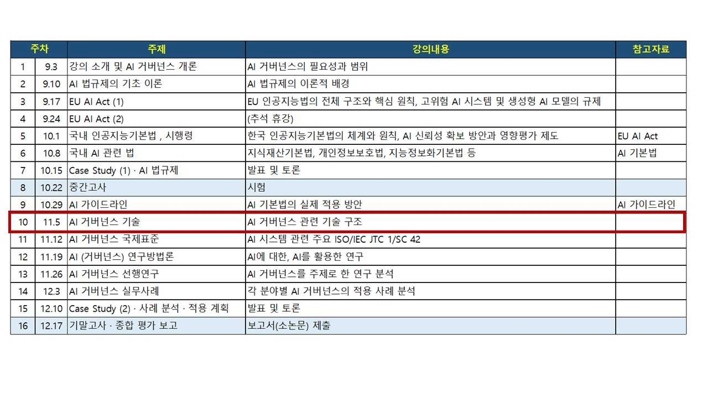

## 10 강. AI 거버넌스 기술

## ★ 강의 교안
<small>https://yangguibee.github.io/AIG2/10%20-%20AI%20%EA%B1%B0%EB%B2%84%EB%84%8C%EC%8A%A4%20%EA%B8%B0%EC%88%A0/(AIG20262_10)_20261105.html</small>

## ★ 강의 교안(상세 자료)
<small>https://yangguibee.github.io/AIG2/10%20-%20AI%20%EA%B1%B0%EB%B2%84%EB%84%8C%EC%8A%A4%20%EA%B8%B0%EC%88%A0/(AIG20262_10)_20261105_detail.html</small>
