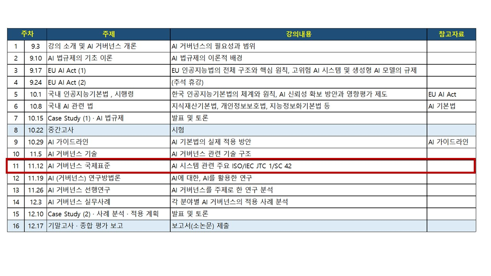

## 11 강. AI 거버넌스 국제표준

## ★ 강의 교안
<small>https://yangguibee.github.io/AIG2/11%20-%20AI%20%EA%B1%B0%EB%B2%84%EB%84%8C%EC%8A%A4%20%EA%B5%AD%EC%A0%9C%ED%91%9C%EC%A4%80/(AIG20262_11)_20261112.html</small>

## ★ 강의 교안(상세 자료)
<small>https://yangguibee.github.io/AIG2/11%20-%20AI%20%EA%B1%B0%EB%B2%84%EB%84%8C%EC%8A%A4%20%EA%B5%AD%EC%A0%9C%ED%91%9C%EC%A4%80/(AIG20262_11)_20261112_detail.html</small>
