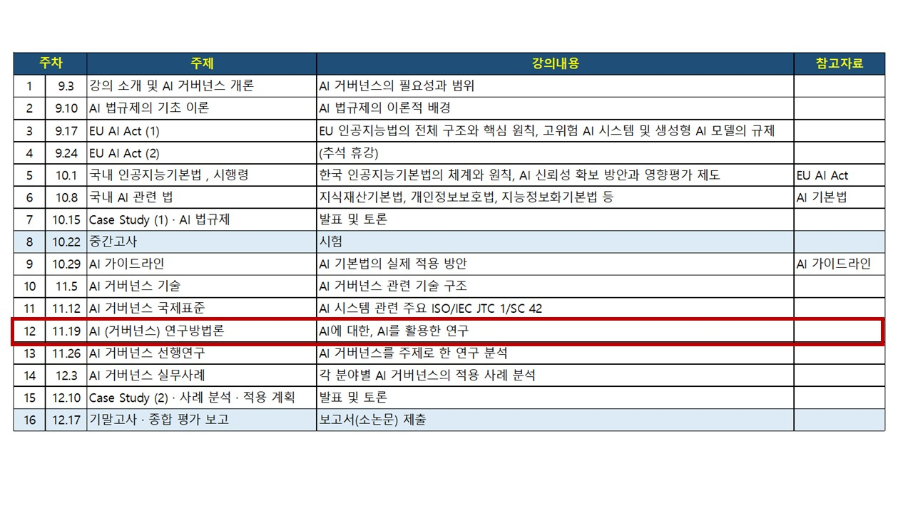

## 12 강. AI (거버넌스) 연구방법론

## ★ 강의 교안
<small>https://yangguibee.github.io/AIG2/12%20-%20AI%20(%EA%B1%B0%EB%B2%84%EB%84%8C%EC%8A%A4)%20%EC%97%B0%EA%B5%AC%EB%B0%A9%EB%B2%95%EB%A1%A0/(AIG20262_12)_20261119.html</small>

## ★ 강의 교안(상세 자료)
<small>https://yangguibee.github.io/AIG2/12%20-%20AI%20(%EA%B1%B0%EB%B2%84%EB%84%8C%EC%8A%A4)%20%EC%97%B0%EA%B5%AC%EB%B0%A9%EB%B2%95%EB%A1%A0/(AIG20262_12)_20261119_detail.html</small>

## ★ 연구이론 맵
<small>https://yangguibee.github.io/research.html</small>

- 시연 예시 1 · TOE 확장(TOPA) — 클라우드 ERP 관리체계 : <small>https://yangguibee.github.io/research.html#ex1</small>
- 시연 예시 2 · 공공 AI 챗봇 시민 이용의도 : <small>https://yangguibee.github.io/research.html#ex2</small>
- 시연 예시 3 · 국가별 AI 규제 비교 : <small>https://yangguibee.github.io/research.html#ex3</small>
