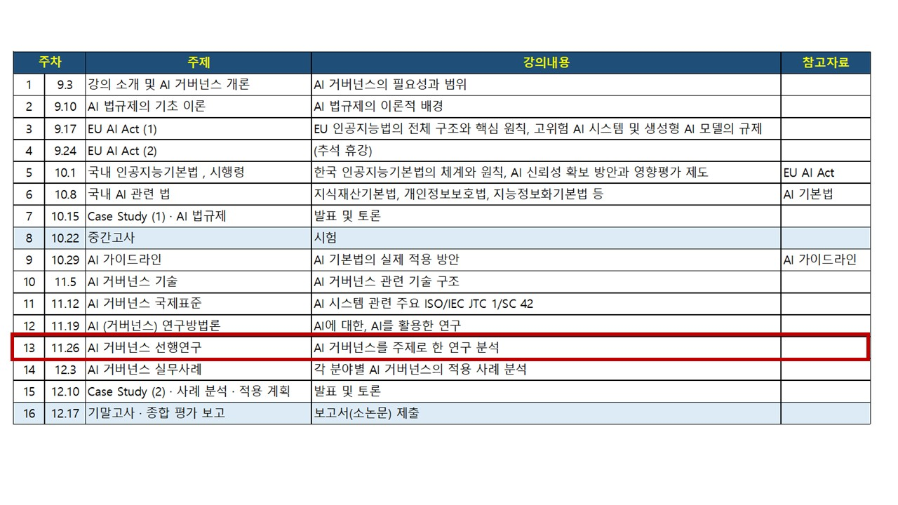

## 13 강. AI 거버넌스 선행연구

## ★ 강의 교안
<small>https://yangguibee.github.io/AIG2/13%20-%20AI%20%EA%B1%B0%EB%B2%84%EB%84%8C%EC%8A%A4%20%EC%84%A0%ED%96%89%EC%97%B0%EA%B5%AC/(AIG20262_13)_20261126.html</small>

## ★ 강의 교안(상세 자료)
<small>https://yangguibee.github.io/AIG2/13%20-%20AI%20%EA%B1%B0%EB%B2%84%EB%84%8C%EC%8A%A4%20%EC%84%A0%ED%96%89%EC%97%B0%EA%B5%AC/(AIG20262_13)_20261126_detail.html</small>

## ★ 리뷰 논문 8편 원문 링크
<small>https://yangguibee.github.io/AIG2/13%20-%20AI%20%EA%B1%B0%EB%B2%84%EB%84%8C%EC%8A%A4%20%EC%84%A0%ED%96%89%EC%97%B0%EA%B5%AC/%EB%A6%AC%EB%B7%B0%EB%85%BC%EB%AC%B88%ED%8E%B8_%EC%9B%90%EB%AC%B8%EB%A7%81%ED%81%AC.html</small>
